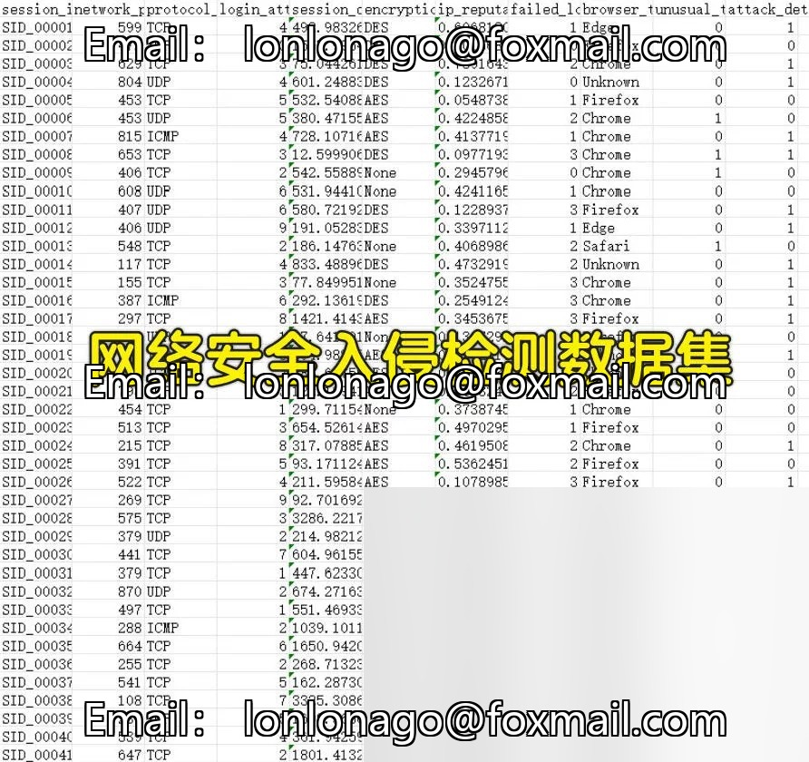
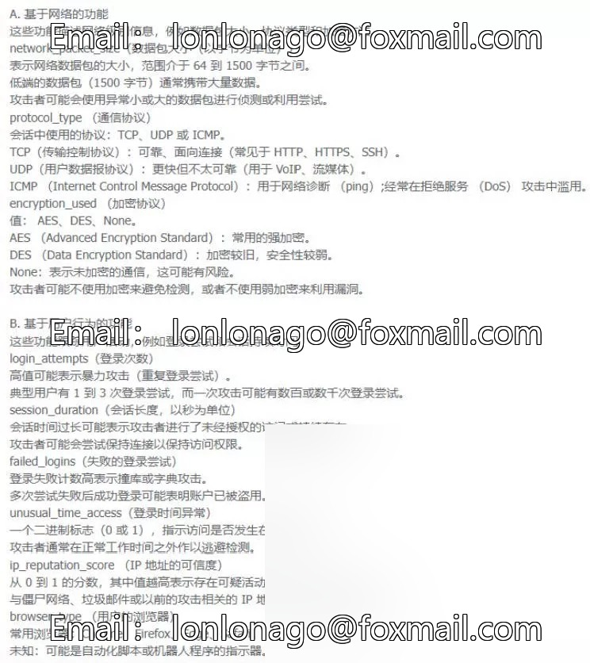

# Network security intrusion detection dataset

## Body

Cybersecurity intrusion detection dataset

The dataset is composed of features based on networks and user behavior. Each function provides valuable information regarding potential network threats.

There are 9,500 samples in Excel format.

web-based shipment, can be directly photographed and shipped.

The dataset consists of network-based and user-behavior-based features with 9,500 samples in Excel format.

<!-- AI_ENRICHED -->

## Images

## Payment

Here is a pay link on Stripe ( https://buy.stripe.com/3cs8yP7sY87d0vu9AB ). Please contact me lonlonago@foxmail.com after funding $89, and I will send you a complete data files , thank you!

